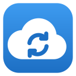

<h1 align="center">drivesync</h1>

<b>Keep the Google Drive folders you choose on your computer, always in sync.</b> 
For Linux first, with macOS and Windows on the way.

> [!WARNING]
> **Very early software. Use it at your own risk.**
> drivesync is new and has barely been used on real accounts yet. Before you use it with files you care about, **keep a separate backup**, and start with a test folder.

> [!NOTE]
> drivesync is an **unofficial**, independent app. It is not made, endorsed or supported by Google. Google Drive is a trademark of Google LLC.

---

## What it does

- **You pick the folders.** Only the Drive folders you tick are copied to your computer, into a folder called **GoogleDrive** in your home folder.
- **Real files.** They open in any app and work without internet. Changes sync back when you're online again.
- **Both ways.** Edit, add, rename or delete on your computer or on drive.google.com, and the other side follows.
- **It lives in your tray.** A small cloud icon shows whether everything is up to date. Click it to see what happened recently, pause syncing or open your folder.

## Install

| | |
| --- | --- |
| **Linux** | **[Install drivesync](https://celso-alexandre.github.io/drivesync/io.github.celso_alexandre.drivesync.flatpakref)** opens in your software center (Discover on KDE, Software on GNOME). Click Install. Updates arrive with your normal system updates. |
| **macOS** | Coming soon. |
| **Windows** | Coming soon. |

After installing, open **drivesync** from your applications menu.

## First start

A short wizard walks you through everything:

1. **Connect your Google account.** drivesync doesn't use a shared key that someone else controls. Instead, you create your own free Google "key" once. The wizard shows you each step and checks what you paste. It takes about 5 minutes, and it's the only fiddly part.
2. **Sign in with Google** and click **Allow**. Your browser opens for this.
3. **Tick the folders** you want on this computer.

That's it. The cloud icon in your tray shows how things are going, and you can tick drivesync to start automatically when you log in.

## The tray icon

| Icon | Meaning |
| --- | --- |
|  | Everything is up to date. |
|  | Copying changes. |
|  | Paused by you. Nothing is copied until you resume. |
|  | Something needs your attention. Click the icon to see what. |
|  | Not signed in yet. |

## How your files are kept safe

- **Nothing is simply erased.** If you delete a file on your computer, it goes to the Drive trash, where you can restore it for 30 days. If a file is deleted on Drive, your copy moves to a hidden trash folder inside your GoogleDrive folder.
- **Both versions survive conflicts.** If a file changed on your computer and on Drive at the same time, you keep both. Yours is saved next to it, with "conflict" and the date in its name.
- **Big deletions are stopped.** If more than half of a folder would be deleted at once, drivesync stops and asks first.
- **A missing folder is never "deleted".** If a disk is unplugged or a folder disappears, drivesync pauses that folder instead of deleting it from Drive.
- **Files you're editing are left alone.** If you change a file while it's syncing, drivesync waits and tries again later.

Empty folders are removed directly, and the Drive trash empties itself after 30 days, so these protections have limits. That's one more reason to keep a backup.

## Privacy

- **Your Google key belongs to you.** No company, including the makers of drivesync, holds a key to your Drive.
- **Your sign-in is stored in your system's password storage** (KWallet, GNOME Keyring, Keychain or Credential Manager), never in a plain file.
- **drivesync talks only to Google.** There are no ads, no tracking and no drivesync servers.
- **It's locked down.** The part that talks to Google runs inside a sandbox provided by your operating system, which limits what it can touch on your computer to its own folders. This guards against bugs and against harmful file names coming from Drive. It cannot protect you from a fake, tampered copy of drivesync, so only install it from the links above.

## Good to know

- Google Docs, Sheets and Slides stay online. They aren't real files, so they aren't copied.
- You can pick folders at the top level of **My Drive**. Shared drives and "Shared with me" aren't supported yet.
- Changes are picked up within about 30 seconds, not instantly.

## For developers

How it's built, tested and sandboxed: [docs/DEVELOPMENT.md](docs/DEVELOPMENT.md).

## License

[Apache License 2.0](LICENSE)
